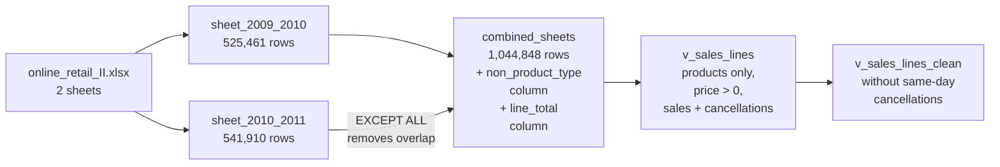

# Online Retail II: Sales Analysis with DuckDB SQL



## Project Summary
This project analyzes two years of transactions, from December 2009 to December 2011, from a UK-based online retailer that mainly sells giftware, often to wholesalers. The data covers over 1 million invoice lines, about 53,600 invoices and £19.0M in net revenue. I loaded the Excel file directly into DuckDB, checked whether the data is plausible, prepared it for analysis and answered 19 business questions with SQL in a Jupyter Notebook. The analysis shows that the business depends strongly on the UK, on the months before Christmas and on a core of repeat customers.

## Business Problem
- How does net revenue develop over time, and when does it peak?
- Which countries generate the most revenue, and where are orders the largest?
- Who are the most important customers, and how often do they come back?
- Which products drive revenue and quantity?
- On which weekdays and at which hours do orders come in?
- How many sales are cancelled, and which products have the highest return rate?

## Approach
1. Loaded both Excel sheets into DuckDB and fixed data types while loading
2. Combined the two sheets and removed the rows that appear in both
3. Checked data quality: date range, missing values, duplicates, cancellations, non-product stock codes and outliers
4. Prepared the data with a revenue column and two views for the analysis
5. Answered 19 business questions with SQL
6. Wrote recommendations with the limitations of the data

## Data Quality Checks
| Problem | Finding | Decision |
|---|---|---|
| Overlapping sheets | Both sheets contain December 2010 | Combined with `EXCEPT ALL` to count rows only once |
| Missing customer IDs | 16.3% of invoices, 13.6% of revenue | Kept for revenue questions, excluded only for customer questions |
| Duplicated rows | About 12,000 rows, 0.2–0.3% of revenue | Kept, because it is unclear whether they are errors |
| Non-product stock codes | Postage, fees, manual adjustments, gift vouchers, tests | Marked with a new column `non_product_type` and excluded |
| Zero and negative prices | 6,024 rows with price 0, 5 with a negative price | Excluded |
| Extreme outliers | One order of 80,995 units, cancelled 12 minutes later | Kept, but compared with a second view without same-day cancellations |
| Incomplete month | Data ends on 9 December 2011 | Excluded from growth calculations |

## Key insights
1. **Strong seasonality:** Net revenue rises strongly from September to November in both years. November 2011 was the best month with £1.43M.
2. **Light growth:** From January to November, net revenue in 2011 was about 2% higher than in the same period of 2010.
3. **Home market:** The United Kingdom generates 85% of the net revenue. Customers in the Netherlands place the largest orders, with an average of £2,545 compared to £466 in the UK.
4. **Loyal customers:** About 72% of the customers with an ID ordered more than once, and they generate about 97% of the revenue from these customers. The top 10 customers alone generate 16%.
5. **Order times:** Most orders come in from Tuesday to Thursday around lunchtime. There are almost no orders on Saturdays.
6. **Cancellations:** 4.2% of all sold units are cancelled. About half of them are orders that were cancelled on the same day. Without these, the rate is 2.2%.

Full analysis: [Jupyter Notebook](analysis/analysis_Online_retail_II.ipynb)

## SQL Techniques Used
- **Aggregation:** `GROUP BY`, `GROUP BY ALL`, `HAVING`, `COUNT(DISTINCT)`, `FILTER (WHERE ...)`, `MEDIAN`, `MODE`, `quantile_cont`
- **Window functions:** `LAG` for month-over-month growth and days between orders, `RANK` for the top 3 products per month, `SUM() OVER` for running totals and shares of the total, `COUNT() OVER (PARTITION BY ...)`
- **Joins and set operations:** `INNER JOIN`, `CROSS JOIN`, `INTERSECT`, `EXCEPT ALL`, `UNION ALL`
- **Subqueries and CTEs:** multi-step queries with `WITH`, correlated subquery with `NOT EXISTS` to find same-day cancellations
- **Data preparation:** `CREATE TABLE AS`, `CREATE VIEW`, `ALTER TABLE`, `UPDATE`, `CASE WHEN`, `CAST`, date conversion and `regexp_matches`

## Tools used
- **DuckDB SQL:** loading the Excel file, data checks, data preparation and analysis
- **Jupyter Notebook in VS Code:** documenting the analysis
- **Python and pandas:** running the queries and displaying the results as tables

## How to run
1. Download `online_retail_II.xlsx` from the UCI link below and save it in the `data` folder.
2. On Windows, create a virtual environment and install the packages:
   ```
   py -m venv .venv
   .venv\Scripts\activate
   python -m pip install --upgrade pip
   pip install -r requirements.txt
   ```
   On macOS or Linux, use `python3 -m venv .venv` and `source .venv/bin/activate` instead.
3. Open the notebook in VS Code and select the `.venv` environment as the kernel.
4. Run all cells. The notebook creates the database file `Online Retail II_Dataset.duckdb` in the `data` folder automatically.

## Dataset
[Online Retail II (UCI Machine Learning Repository)](https://archive.ics.uci.edu/dataset/502/online+retail+ii) by Daqing Chen, licensed under [CC BY 4.0](https://creativecommons.org/licenses/by/4.0/). I cleaned and combined the data for this analysis.

## Files
- `analysis/analysis_Online_retail_II.ipynb`: data loading, quality checks, data preparation and all business questions with results
- `data/README.md`: instructions for downloading the dataset
- `requirements.txt`: Python packages needed to run the notebook

The Excel file and the DuckDB database are not included in this repository, because they are large and can be downloaded or recreated. Please download the data from the UCI link above.
